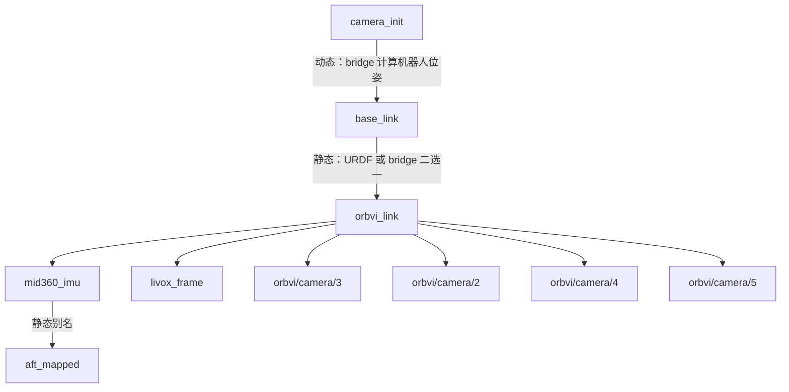

# 机器人安装、TF 与地面 IPM

板端 Omni-LIVO/native → SDK → 用户主机上的 ROS bridge → ROS topic/TF。
机器人 IPM 由板端 GPU 生成，SDK 传输结果与生成参数；客户端 bridge 负责 ROS 封装和 TF。
Camera Runtime 与 SDK Server 必须配套升级至支持机器人 GPU 投影的版本。

## 坐标系与所有权

`T_A_B` 将 B 系点转换到 A 系，平移为米。`aft_mapped` 是 MID360 IMU 状态系，
不是设备中心。`orbvi_link` 是 SDK ROS_BODY 参考系：原点沿用相机 rig 定义，
坐标轴为前、左、上，不假定为外壳几何中心。原始相机为右、下、前的光学系。

| Frame | 定义 | 机器人模式发布职责 |
| --- | --- | --- |
| `camera_init` | Omni-LIVO 初始化世界系 | bridge 根据原始 IMU 位姿计算机器人动态边 |
| `base_link`（可配置） | 机器人本体系，前/左/上 | URDF 定义；安装边由 URDF 或 bridge 拥有 |
| `orbvi_link`（可配置） | SDK ROS_BODY，相机 rig 参考原点，前/左/上 | bridge 使用 SDK 内部标定连接各传感器 |
| `mid360_imu` / `aft_mapped` | 雷达 IMU 状态系及原位姿 frame 别名 | bridge 静态边 |
| `livox_frame` | 雷达点坐标系 | bridge 静态边 |
| `orbvi/camera/<id>` | 四路原始相机光学系，右/下/前 | bridge 静态边 |

默认 `tf_mode:=device` 沿用 [设备 TF 树](TF.md)。显式启用 `tf_mode:=robot` 后：



SDK 提供内部标定，bridge 将其封装为 ROS 静态 TF。机器人 URDF 默认拥有
`base_link → orbvi_link`，bridge 的 `publish_mounting_tf` 默认关闭。
没有 URDF 时，显式开启该开关由 bridge 发布安装边；不得让两者同时发布这条边。
独立定位/融合节点若已拥有 `camera_init → base_link`，关闭 bridge 的
`publish_vio_tf`，由集成方处理世界系关系。

机器人模式将传感器静态边重挂到设备参考系，并保留 `mid360_imu → aft_mapped`
的单位变换作为原 IMU frame 的别名，不再广播旧的动态 `camera_init → aft_mapped`。
ROS_BODY 深度点云直接使用 `orbvi_link`，无须再发布重合的 depth frame。
完整树由 bridge 发布 7 条传感器静态边，另有 1 条安装边由 URDF/bridge 发布。

## 通过 SDK 读取板端安装配置

推荐把唯一的安装数值和地面平面配置在板端 Camera Runtime profile 的
`bev.robot_projection` 中（字段见 SDK 主仓库 `docs/orbvi/board-gpu-bev.md`）。
ROS1/ROS2 使用现有 `mounting_config` 参数的特殊值 `sdk`：

```bash
ros2 launch orbvi_ros_bridge orbvi_ros_bridge_mid360.launch.py \
  host:=DEVICE_IP tf_mode:=robot mounting_config:=sdk \
  publish_mounting_tf:=true publish_ipm:=true
```

bridge 启动时通过一次有超时上限的 SDK BEV 订阅读取参数快照，然后停止临时订阅。
`T_base_orbvi`、ground_plane 和 frame 名全部来自实际 GPU 输出；无须另外填写安装
YAML。旧板端没有机器人快照时明确启动失败，不补单位外参。
有 URDF 时使用 `publish_mounting_tf:=false`，它发布的安装关系必须和快照一致。
实时 GPU IPM 每帧都与经过所有权审计的 TF、地面平面和相机标定 hash 核对；冲突或
板端参数变更时跳帧并限频诊断，需要统一配置并重启，其他传感器 topic 独立运行。
安装边仍由 URDF/bridge 二选一发布，IPM 不额外发布 TF。

## 安装配置

安装数值只保留在一个来源中，模式切换时需要换用对应配置：

| 模式 | `publish_mounting_tf` | 安装数值来源 | bridge 配置示例 |
| --- | --- | --- | --- |
| URDF | `false`（默认） | robot_state_publisher 的静态 TF | `config/mounting-urdf.example.yaml`，只有 parent/child，禁止 xyz/rpy |
| bridge | `true` | bridge YAML | `config/mounting-upright.example.yaml` 或 `mounting-inverted.example.yaml`，必须有 xyz/rpy |

URDF 模式：

```yaml
orbvi:
  mounting:
    parent_frame: base_link
    child_frame: orbvi_link
  ground_plane: [0.0, 0.0, 1.0, 0.0]
```

bridge 模式：

```yaml
orbvi:
  mounting:
    parent_frame: base_link
    child_frame: orbvi_link
    xyz: [0.20, 0.0, 0.35]
    rpy: [3.141592653589793, 0.0, 0.0]
  ground_plane: [0.0, 0.0, 1.0, 0.0]
```

示例数值不是用户机器人的安装测量。`xyz` 是设备参考原点在机器人系中的位置；
`rpy` 是最终安装姿态，弧度制，固定轴 `Rz(yaw) * Ry(pitch) * Rx(roll)`。
改变旋转支点时须重新确定平移。内部标定不随安装方向变化。
`ground_plane` 在机器人 parent_frame 下表达，两种模式都可配置，IPM/启动 odom
要求显式提供；不启用这两个功能时可省略。

ROS1，由 URDF 发布安装边：

```bash
roslaunch orbvi_ros_bridge orbvi_ros_bridge_mid360.launch \
  host:=DEVICE_IP tf_mode:=robot \
  mounting_config:=/absolute/path/mounting-urdf.yaml
```

需要由本地 YAML/URDF 定义 TF 时，继续使用以下兼容方式：

```bash
ros2 launch orbvi_ros_bridge orbvi_ros_bridge_mid360.launch.py \
  host:=DEVICE_IP tf_mode:=robot mounting_config:=/absolute/path/mounting-inverted.yaml \
  publish_mounting_tf:=true publish_ipm:=true
```

该模式不把本地 YAML 自动写入板端；板端 GPU 参数必须与经过审计的 TF/地面平面一致，
否则 IPM 被拒绝。新增部署优先选择 `mounting_config:=sdk`，避免重复维护安装参数。

三套 launch 在 ROS1/ROS2 中均透传上述参数。URDF 模式迁移时，删除原 bridge YAML
中的 xyz/rpy；继续使用旧数值配置会明确报错，不会悄悄回退到第二份安装真值。
自定义 parent/child 名称受支持。ROS_BODY 深度点云默认使用 child_frame；显式
`depth_pointcloud_frame_id` 必须与 child_frame 一致。frame 冲突、非法数值、重复键
及未知项会被拒绝。安装、标定和 IPM 映射作为启动快照使用，变更后重启 bridge。

### 安装边互斥与诊断

`config/robot-mount.example.urdf.xacro` 提供 `publish_mounting_tf` 开关：
为 true 时不生成设备 link 和安装 joint，为 false 时由 URDF 生成安装 joint。
集成 launch 必须将**同一个**开关同时传给 xacro 和 bridge。例如 ROS1 外层 launch：

```xml
<arg name="publish_mounting_tf" default="false"/>
<arg name="mounting_config"/>
<param name="robot_description" command="$(find xacro)/xacro $(find orbvi_ros_bridge)/config/robot-mount.example.urdf.xacro publish_mounting_tf:=$(arg publish_mounting_tf)"/>
<node pkg="robot_state_publisher" type="robot_state_publisher" name="robot_state_publisher"/>
<include file="$(find orbvi_ros_bridge)/launch/orbvi_ros_bridge_mid360.launch">
  <arg name="tf_mode" value="robot"/>
  <arg name="mounting_config" value="$(arg mounting_config)"/>
  <arg name="publish_mounting_tf" value="$(arg publish_mounting_tf)"/>
</include>
```

ROS2 使用同一个 LaunchConfiguration 值生成 xacro Command，并传入 bridge 参数。
这份 xacro 是最小示例，实际机器人应合并到自身 URDF。它不能禁止其他独立节点
发布安装 TF；部署时仍须明确所有权。bridge 在认领安装边前等待 500 ms 发现已有
发布者，并持续按 ROS1 callerid / ROS2 publisher GID 审计路径。发现多发布者、
数值/parent 变化、动态安装边或环路时，暂停依赖它的机器人动态 TF/IPM并限频诊断，
保留原始图像、IMU、深度 topic 和 IMU Odometry。冲突记录锁定到进程结束；解决
冲突后重启 bridge。TF 不支持撤回旧静态记录，消费者缓存中的旧 TF 不会自动消失。

URDF 缺边时等待，边稍后到达可自动恢复；不生成单位安装外参。桥接模式关闭
`publish_sensor_tf` 时，安装与内部标定只进入本地 tf2 buffer，不向网络广播，
机器人位姿/IPM仍可使用它们。URDF 模式即使关闭 bridge 静态 TF，仍需外部安装边。
`publish_sensor_tf` 不控制外部 URDF；关闭所有 bridge TF 时还应保持
`publish_odom_tf:=false`。

## 机器人位姿计算

Omni-LIVO 输出 `T_world_imu`。bridge 通过实际 tf2 buffer 查询
`T_base_mid360_imu`，独立审计该路径全为静态且只有一个发布者后计算：

```text
T_world_base = T_world_imu * inverse(T_base_mid360_imu)
```

IPM 同样从该 buffer 查询 `T_base_camera`；URDF 模式不再读取任何安装 xyz/rpy。
bridge 模式将自己发布的安装边放入同一 buffer，二者共用同一个冻结快照。
保留原采样时间、优化位姿合法性和序列门控，不以接收时间代替采样时间。
原 `/orbvi/vio/odometry` 和 `/orbvi/vio/path` 保留 IMU 数据契约；其速度和协方差
未转换到机器人参考点。需要机器人位姿可查询 `camera_init → base_link`。

没有有效的设备—IMU 标定时，停止机器人动态 TF，保留原 Odometry 和独立有效
静态分支，不用单位外参替代。关闭 `publish_sensor_tf` 后，机器人动态 TF 所需
的标定仍会加载。
缺失连接锚点时，独立有效的雷达/IMU 分支仍保留在 `aft_mapped` 下，相机分支
保留在设备系下；这些分支暂时不连通，不声称可以查询机器人到所有传感器的完整树。

## 可选启动 odom 原点

当前 native 的 `camera_init` 已做重力对齐，但原点在初始化 IMU 参考点，yaw 也
不保证是机器人前方。默认不改变此行为；需要启动 footprint 归零和初始机器人
航向归零时启用 `publish_odom_tf:=true odom_frame:=odom`。必须同时使用
`tf_mode:=robot publish_vio_tf:=true`，并提供机器人系下的 ground_plane。

```text
odom → camera_init → base_link → orbvi_link → sensors
 静态                  动态       安装/内部静态
```

首个通过校验的机器人位姿到达后，仅计算一次 `T_odom_camera_init`：以世界竖直
方向将机器人原点投影到配置的地面平面，投影点作为 odom 原点；以机器人 +X
在水平面的投影定义初始 yaw。odom 保持世界 Z-up，不把机器人实际 roll/pitch
强行置零。机器人原点保持其离地高度，**不是把 base_link 本身搬到地面**。
倾斜地面仅保证起始投影点 z=0，不保证整个倾斜平面都处于 z=0。
没有创建虚构的 base_footprint frame，也不估计真实地面。

此功能要求 native 已使用 `gravity-aligned-z-up-v1` 世界系；旧 SDK 未提供自动
世界语义查询，需按板端版本/status 确认后开启。它不再次执行重力调平。
算法重启若被位姿代次门控识别，启用 odom 的机器人输出会暂停并要求重启 bridge，
防止把旧静态锚点用于新世界。没有可识别代次且时钟倒退时也须重启 bridge。
`odom → camera_init` 必须由本 bridge 独占；未来重定位节点可拥有 `map → odom`，
本功能不发布 map。没有首帧位姿时不伪造 odom 边。

## 机器人地面 IPM

当前 GPU IPM 实现的验证记录统一保存在 SDK 主仓库
`docs/validation/2026-10-15-robot-gpu-ipm.md`（同名功能分支）。
[安装 TF 与启动 odom 修复验收](validation/2026-10-15-tf-ownership-fix.md)和
[上一轮复核](validation/2026-10-15-world-frame-review.md)是本次 GPU 迁移前的历史记录，
不能证明新版端到端链路已经完成部署验收。

启用机器人模式及 `publish_ipm`（或 bev 流）时，bridge 订阅板端 GPU 的
`bev_display_stream`，读取生成参数快照并与实际 TF 核对，然后发布图像。
不再包含 bridge 自有的 CPU RobotIpmGenerator；板端流不支持时只禁用该 IPM 分支，
保留其他 topic。设备模式继续保留原有的旧 SDK CPU 回退行为。

`ground_plane` 来自 SDK 快照或兼容 YAML，必须显式提供，定义为机器人 parent_frame 中的
`nx*x + ny*y + nz*z + d = 0`。例如 `[0,0,1,0]` 是 z=0；如果 base_link
原点离地 h 米，水平地面应填写 `[0,0,1,h]`。这与设备安装高度是不同参数。
非零法向量可不归一化，但平面不能近乎竖直（归一化后 |nz| 必须至少为 0.1）。

每个输出像素对应机器人平面上的一个点：

```text
x_base = extent_m - (row + 0.5) * resolution_m_per_pixel
y_base = extent_m - (col + 0.5) * resolution_m_per_pixel
z_base = -(nx*x_base + ny*y_base + d) / nz
p_camera = inverse(T_base_camera_used_by_GPU) * p_base
```

板端使用标定的 triple-sphere 鱼眼模型生成不可变 LUT，逐帧经 OpenCL 双线性采样
和有效视野融合，输出 NV12 DMA-BUF，再由硬件 JPEG 编码。Host SDK 解码为 BGR8，
bridge 发布 `/orbvi/ipm/image`；frame 与采样时间戳沿用 GPU 输出，不使用接收时间。
机器人模式不会通过替换 header 或旋转最终图片模拟安装适配。

机器人模式下 `ipm_frame_id` 必须与安装 parent_frame 一致。GPU extent/resolution
由板端 profile 决定，现有 `ipm_extent_m`、`ipm_resolution_m_per_pixel`、
`ipm_camera_height_m` 和 `ipm_max_publish_rate_hz` 仅用于旧设备模式的 CPU 回退。
当前板端 extent 保持 10 m，默认输出 1000×1000，边长上限 1024；沿用原有 OpenCL
kernel、缓冲池与 demand gate。相机身份仅用于绑定图像和标定，机器人方位由完整
几何决定。安装改变后实际视野可能变化，不保证正装与倒装覆盖完全相同。

标定不匹配、机器人元数据缺失/非法、GPU 标志缺失、TF 未就绪或冲突、平面不一致时
跳过该 IPM 帧并限频诊断；不回退 CPU，不影响独立有效的传感器 topic。

这里只输出单帧 IPM，未实现世界系多帧 BEV 累积。后续累积必须缓存图像并按采样
时间查询动态位姿，不能使用 latest TF；当前不宣称已提供该缓存/插值功能。

## 导出与验证

```bash
orbvi_export_extrinsics --host DEVICE_IP --output NEW_FILE.json \
  --tf-mode robot --mounting-config sdk \
  --publish-mounting-tf true
```

使用 sdk 时，安装数值来自 GPU 快照；使用本地文件时遵循上文兼容规则。
不带最后一个开关时，导出仅含 SDK 内部静态边；本地文件必须是无 xyz/rpy 的 URDF 配置；
工具不连接 ROS TF，不能导出外部 URDF 安装数值或动态/启动 odom 边。
导出与 ROS1/ROS2 复用相同重挂计算，保留相机/雷达标定 hash；安装边中的数值
来自 SDK 快照或显式的兼容 YAML。导出只描述 TF，不将机器人地面平面假定成设备标定。

bridge 几何测试覆盖安装旋转、平移杆臂、逆变换、完整树及缺标定；GPU 快照测试覆盖
安装、旋转符号、平面尺度、hash、旧版/错帧拒绝。投影与 GPU 采样测试在 SDK 主仓库，
包括正装/倒装/90° 几何和实际 Mali GPU；真实相机端到端部署和长时间性能仍须补测，
以该仓库本轮验证记录为准。

RViz 可沿用仓库的 `visuallize_config/rviz-config.rviz`（ROS1）或
`rviz-config-ros2.rviz`（ROS2），已有 Sensor TF display。有优化位姿时 Fixed Frame
使用 `camera_init`（开启启动 odom 时可用 `odom`）；仅静态传感器时改为安装
parent（默认 `base_link`）。
添加 Image display 查看 `/orbvi/ipm/image`；图像上方为机器人前方。

快速检查发布与连通性：

```bash
# ROS1
rosrun tf2_ros tf2_echo base_link orbvi/camera/3
rostopic hz /orbvi/ipm/image
# ROS2
ros2 run tf2_ros tf2_echo base_link orbvi/camera/3
ros2 topic hz /orbvi/ipm/image
```

要用单条命令验证四路相机、雷达、IMU、深度点云和 IPM，可在独立 ROS 网络运行
`test/probe_tf.py --mode static-only --tf-mode robot --mounting-config FILE
--publish-mounting-tf --include-depth --include-ipm`，并补齐 `--ros`、`--host`、
`--bridge-executable`、`--output`。ROS2 使用正式 launch 的共享内存配置时，
探针也必须使用相同的 Fast DDS profile 和 RMW，Docker 配置足够的 `/dev/shm`。
