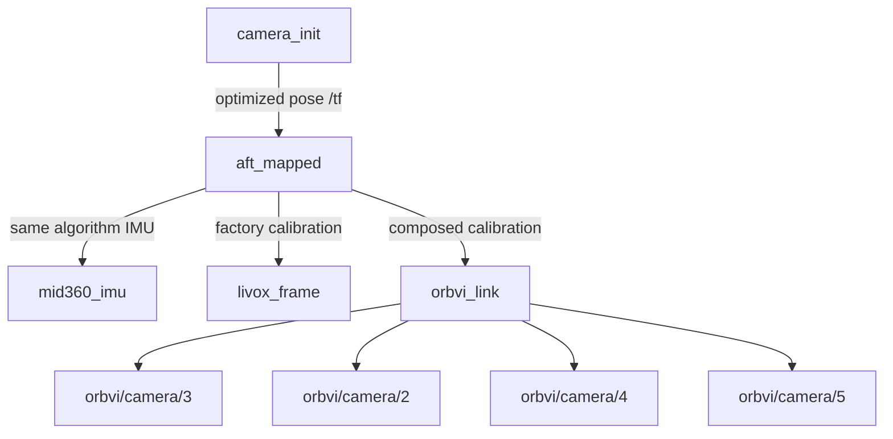

# Omni-LIVO TF and extrinsic calibration

The board runs ROS-free Omni-LIVO. The external `orbvi_ros_bridge` consumes the
Host SDK; ROS1 Noetic and ROS2 Humble use the same transform geometry. No board
service or native algorithm is changed by this feature.

## Frames and transforms

`T_A_B` maps B coordinates into A: `p_A = R_A_B * p_B + t_A_B`. Translations
are in metres, exported quaternions are `[x,y,z,w]`. Image frames use optical
axes (right, down, forward); the SDK ROS_BODY axes are forward, left, up.



The four IDs above are RK3588 4VL IDs. Geometry and image messages use the SDK
camera ID, not array position, stereo pair ID, or MIPI index. The front camera
is selected by its calibrated `role`. The static tree has seven edges when
complete. `aft_mapped` is the native estimator's MID360 IMU state; the identity
edge to `mid360_imu` describes that same physical frame, not missing calibration.

The shared calculation follows the native runtime:

- `T_reference_lidar = T_reference_front * T_front_lidar`.
- `T_base_reference` maps `(x,y,z)` to `(z,-x,-y)` without translation.
- `T_imu_base = T_imu_lidar * inverse(T_base_reference * T_reference_lidar)`.
- `T_base_camera = T_base_reference * T_reference_camera`.

Only the front-camera/LiDAR anchor is composed with the four-camera rig. The
other three independent FAST-Calib files are not used to construct competing
paths. If the SDK rejects an incomplete LiDAR bundle, the shared module parses
the remaining explicitly identified IMU and camera entries independently. It
requires READY MID360 metadata and consistent snapshot hashes; malformed entries
are omitted. The original SDK/protocol remains unchanged.

`orbvi_link` is the device-fixed reference: the SDK ROS_BODY origin with axes
forward, left, up. ROS_BODY depth point clouds use that same frame directly;
there is no separate depth-frame transform because their coordinates coincide.
The camera frames are optical (right, down, forward), despite their historical
names without an `_optical_frame` suffix. Their calibrated transforms include
the optical-to-body axis rotation. No physical housing-centre origin is assumed.

The bridge now defaults to `orbvi_link` instead of the SDK's historical
`base_link`, reserving `base_link` for the customer's robot. For legacy users,
set `depth_pointcloud_frame_id:=base_link`: both ROS_BODY cloud headers and the
static tree then use `base_link`. All three ROS1/ROS2 bridge launch entrypoints
forward this parameter. An empty value selects `orbvi_link` only for ROS_BODY;
other point-cloud coordinate modes retain SDK frame defaults. A custom nonempty
value selects the same ROS_BODY reference under a different name; it does not
apply a physical mounting transform.

In the default `tf_mode:=device`, keep the LiDAR and IMU branches under `aft_mapped` so they survive unavailable
camera calibration. A TF query between sensors traverses the tree automatically.
Do not add `base_link -> orbvi_link` while `aft_mapped -> orbvi_link` is present:
a child must have exactly one parent. Robot integration with that mounting edge
requires recomputing the dynamic robot pose from the IMU pose and mounting
extrinsic, and replacing/reparenting the existing path accordingly. Internal
sensor extrinsics stay fixed when the device is mounted upside down.
The optional `tf_mode:=robot` implements that reparenting and publishes
`camera_init -> base_link -> orbvi_link -> sensors`. It requires an explicit
installation config; in default URDF mode it contains frame names only, and
both pose and IPM read actual static TF. Bridge ownership instead requires
xyz/rpy in YAML. Duplicate publishers or changing paths pause robot outputs. See
[robot installation, TF ownership and ground IPM](ROBOT_INTEGRATION.md).

In device mode, IPM/BEV retains its existing display semantics and separately
configured header. Robot mode computes a new IPM from raw cameras, full mounting
extrinsics and an explicit robot ground plane; its frame is the mounting parent.
Neither mode invents TF for panoramas or virtual cameras, or infers a ground
plane or installation transform from a frame name.

## Publication and compatibility

| Parameter | Default | Effect |
| --- | --- | --- |
| `publish_vio_tf` | `true` | Publish optimized Odometry as dynamic TF. |
| `publish_sensor_tf` | inherits `publish_vio_tf` | Publish calibrated static sensor branches. |
| `depth_pointcloud_frame_id` | empty (ROS_BODY: `orbvi_link`) | Name shared by the ROS_BODY cloud and its static TF; `base_link` restores legacy naming. |
| `tf_mode` | `device` | `robot` converts IMU pose into robot pose and reparents static sensors. |
| `mounting_config` | empty | URDF: frame names only (xyz/rpy rejected). Bridge: xyz/rpy required. Explicit robot ground plane for IPM/odom. |
| `publish_mounting_tf` | `false` | Bridge owns configured mounting when true; otherwise resolve external static mounting TF. |
| `publish_odom_tf` | `false` | Robot mode: static startup odom → camera_init; explicit ground plane, dynamic TF and native Z-up required. |
| `odom_frame` | `odom` | Parent frame for optional startup anchor. |

All three bridge launch entrypoints forward these settings, in ROS1 and ROS2.
For sensor-only operation, set `publish_vio_tf:=false publish_sensor_tf:=true`;
static publication does not require the `vio` stream or a first pose. To disable
all bridge TF, set `publish_vio_tf:=false`, leave `publish_sensor_tf` unspecified,
and keep `publish_odom_tf:=false`. External URDF publication is independent.
Only one bridge instance should own these edges in a ROS network.

Static transforms are published immediately from one calibration snapshot at
startup. Bridge-owned robot installation waits 500 ms for existing publishers;
URDF installation is awaited without inventing a fallback. ROS1 uses the latched static broadcaster; ROS2 uses the standard
reliable/transient-local static broadcaster, including for late subscribers.
Restart the bridge after changing calibration. Failed calibration fetches and
invalid/missing dependencies emit diagnostics and omit affected branches;
independent valid branches remain available. There are no fabricated identity
fallbacks. An SDK parser failure is retained as a diagnostic even when individual
valid LiDAR branches can be recovered. A failed camera-rig parser omits that rig.

In device mode dynamic TF retains the Odometry parent/child and sample timestamp.
In robot mode it applies `T_world_imu * T_imu_device * inverse(T_base_device)`
using the audited tf2 lookup `T_base_mid360_imu` (the inverse is the pose
correction), and uses the mounting parent as child; source Odometry and Path remain in the
IMU frame. Both modes exclude
IMU predictions, non-finite poses, invalid frame names, non-realtime/zero times,
invalid tracking samples, duplicate sequences and non-increasing timestamps.
Odometry/topic publication remains independent of TF rejection. Quaternions
are normalized when broadcasting, as in the previous ROS2 implementation.

When `boot_id`/`generation` metadata is available, a new producer epoch resets
the gate; a bounded history rejects samples from the last 16 retired epochs.
SDK Servers with pose epoch forwarding preserve both producer header fields
for VINS and Omni-LIVO. Older board versions can omit them: then strictly
forward time is required, and a sequence decrease with forward time is logged
as a producer restart. An unknown-epoch backwards clock reset cannot safely be distinguished
from a delayed sample; restart the bridge in that case. This feature does not
change the SDK wire protocol or synthesize producer epochs.

Two ROS message frame labels are corrected:

| Message | Frame |
| --- | --- |
| Raw single-camera compressed and decoded images | `orbvi/camera/<SDK camera ID>` |
| MID360 IMU | `mid360_imu` (previously `livox_frame`) |
| MID360 point cloud | `livox_frame` (unchanged) |

Image topic names and pixel data are unchanged; frame normalization removes
unstable bundle/synchronization-group labels from individual raw images. IMU
values are unchanged and remain in their original sensor axes. Consumers that
hard-code the previous image or LiDAR IMU frame labels must update accordingly.
Rectified atlases, per-pair virtual cameras, panoramas and the separate device
IMU are not attached using guessed extrinsics. This release does not add
CameraInfo or a `map` transform. Optional startup `odom → camera_init` derives
its origin and yaw from the first valid robot pose and explicit robot ground
plane, keeping native world Z-up. It does not infer gravity or ground height.
An identified algorithm restart pauses this mode until bridge restart; the
old static anchor must not be reused across changed algorithm worlds.

## Tracking diagnostics and point-cloud comparison

Omni-LIVO `OPTIMIZED` records go to `vio/odometry` and `vio/path`;
`PROPAGATED` records go to `vio/imu_prediction`, including predictions marked
`DEGRADED`. Both ROS versions use the same routing. Prediction receipt does not
mean tracking has recovered. Optimized records in `DEGRADED/recovering` remain
available as Odometry, but do not advance optimized TF. The rejection
warning includes `tracking_state` and `tracking_reason`; other reasons identify
invalid sample time, duplicate/out-of-order time or sequence, retired producer
epoch, invalid Odometry frames/pose, or unavailable robot calibration.
The first rejection is reported immediately. Further rejection/recovery reports
are limited to one per 60 seconds, with accepted/rejected optimized-pose counts
since the preceding report. Recovery is INFO and requires five seconds of
uninterrupted acceptance plus an eligible report interval. This suppresses
repeated `recovering` warnings and rapid state oscillations without changing
the TF quality gate. The interval uses the host's monotonic clock.
Do not replace the source timestamp with receive time or turn degraded
predictions into optimized TF to hide these warnings.

For alignment diagnostics, first compare `/orbvi/depth/points` with raw
`/orbvi/lidar/points` using RViz Fixed Frame `orbvi_link`. Enable the `lidar`
stream and `publish_lidar_pcl` to obtain the latter. This comparison uses only
static calibration. The ordinary camera launch does not subscribe to LiDAR
by default; a point cloud from another publisher is a different comparison.

Omni-LIVO scan/map clouds are already expressed in `camera_init`. Comparing
them with depth in that world additionally requires the optimized transform at
the depth image's sample timestamp. TF pauses during degraded tracking; do not
substitute the latest pose when a sample-time lookup is unavailable. Compare
current scans separately from retained map points, and clear old RViz clouds
after a localization restart. A discrepancy already present when projecting
raw LiDAR into the matching rectified disparity cannot be corrected by changing
the world TF. Investigate disparity/depth quality and calibration separately.

## Export

After installing the bridge, run the standalone tool (no roscore required):

```bash
orbvi_export_extrinsics --host DEVICE_IP --control-port 18088 --output extrinsics.json
```

The new JSON file contains parent/child frames, translation in metres,
quaternion order, camera/LiDAR calibration hashes, and omitted-branch diagnostics.
It uses exactly the same geometry as both broadcasters. Exit code `0` means a
complete snapshot, `3` means a partial snapshot was written, and `1` means a
connection, argument or output error. Existing output files are not overwritten.
Use `--device-frame base_link` (or the custom ROS_BODY name) when exporting
for a bridge configured with that legacy/custom frame. The default is
`--device-frame orbvi_link`.
An empty or unverifiable hash is not upgraded to a verified provenance claim.
Robot export uses `--tf-mode robot --mounting-config FILE`; append
`--publish-mounting-tf true` with numerical mounting YAML to include the
bridge-owned installation edge. Without it use frame-only URDF config: the
standalone exporter exports internal calibration, without querying ROS TF.
It cannot export external mounting or dynamic/startup odom edges.

## Verification

Run the existing container builds/tests plus the shared `test_transform_geometry`.
It checks nontrivial rigid transformations against independently known physical
points, camera paths, graph validity, partial calibration and pose ordering.

`orbvi_ros_bridge/test/probe_tf.py` launches a local bridge against a real board
and records message counts, late-subscriber static edges, matched Odometry/TF,
image/IMU frame identities, publisher identities and bounded process CPU/RSS
samples. Use an isolated ROS1 master or ROS2 domain; it never changes board
services. Example inside the matching ROS environment:

```bash
python3 orbvi_ros_bridge/test/probe_tf.py --ros 1 --host DEVICE_IP \
  --bridge-executable /path/to/orbvi_ros_bridge_node --duration 30 \
  --mode full --output evidence/ros1-full.json
```

Repeat with `--ros 2` and modes `sensors`, `disabled`, `static-only`,
`dynamic-only`. Compare exported transforms with the recorded static edges.
`test/compare_extrinsics.py` independently checks a saved SDK calibration JSON
against the export and both probe reports (test-only dependency: NumPy).
Raw rounded rotation matrices have a separately reported tolerance; export and
broadcast values must agree to `1e-12`. For older ROS2 publisher builds, the
probe's `--sensor-reader-best-effort` selects compatible sensor subscriptions
when measuring resources; TF and Odometry subscriptions remain reliable.
For motion acceptance use `--duration 600` while an operator translates and
rotates the device; a stationary recording does not establish motion quality.
Use the same streams, host, board configuration and load when comparing CPU,
RSS and output rates. Check native runtime PID/restarts before and after bridge
shutdown. Existing algorithm quality problems remain separate acceptance items.

`test/record_tf_samples.py` records all TF/poses and each camera/LiDAR/IMU topic
at most once per second into a ROS1 or ROS2 bag. It bounds the estimated payload
budget (default 1500 MiB) and records its counters in a separate summary. This
is a sampled geometry/continuity record, not a lossless sensor capture. In a
separate terminal, source the matching workspace and run:

```bash
python3 orbvi_ros_bridge/test/record_tf_samples.py --ros 2 --duration 660 \
  --output evidence/motion-samples
```

Include `--include-lidar` in the probe to publish the LiDAR data topic as well.
Use `--include-depth` to check actual ROS_BODY point-cloud frame IDs alongside
TF; `--device-frame base_link` also checks the legacy frame override.
ROS1 recording requires the `rosbag` Python module and LZ4 support; ROS2 requires
`rosbag2_py`, both separate test dependencies rather than native runtime ones.
Inspect the recording summary for errors or interruption before calling a run
complete. Analyse closed bags; concurrent SQLite readers can block a ROS2 writer.

The local board validation record is in
[2026-10-15-omni-livo-tf.md](validation/2026-10-15-omni-livo-tf.md).

The device-frame naming migration and its separate verification scope are in
[2026-10-15-device-frame.md](validation/2026-10-15-device-frame.md).
